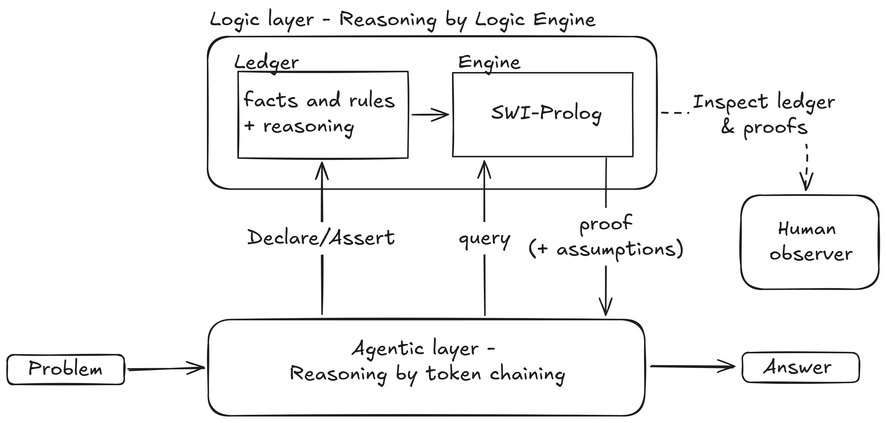
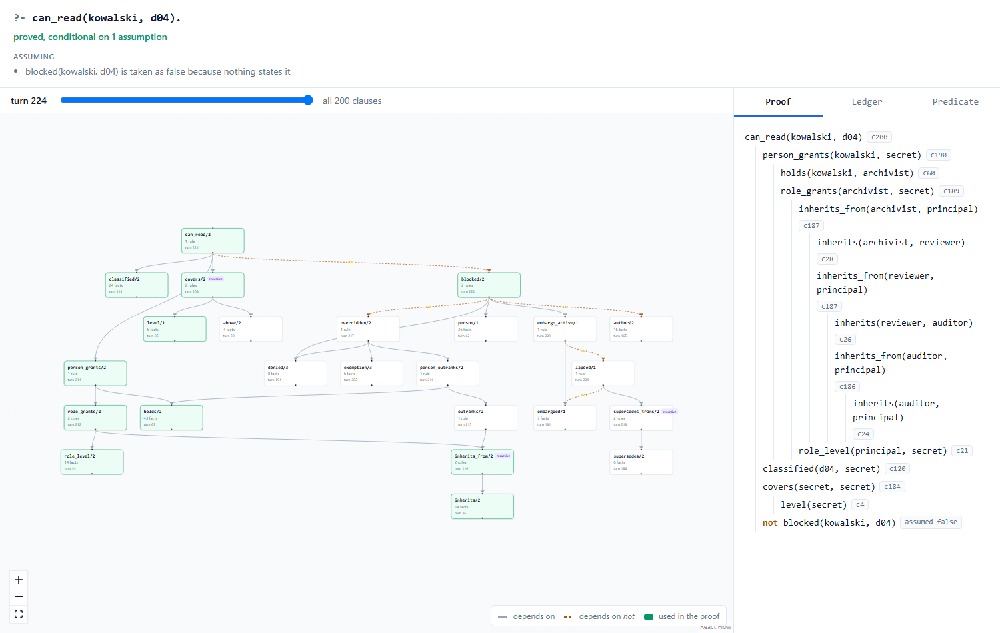
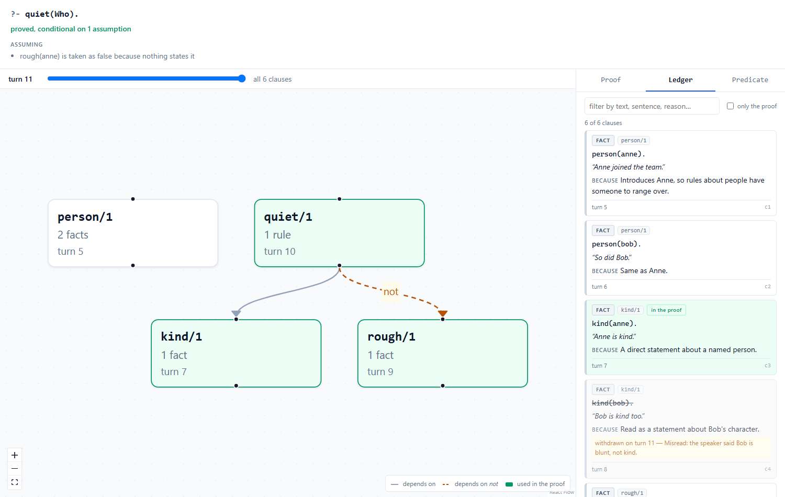

# Logic Layer

A command-line logic engine for coding agents. The agent writes facts and rules
into it, asks it questions, and gets back answers with a proof. Reasoning hence moves from token chaining to a dedicated reasoning engine, with the added benefit of transparency for human observers.



The agent reasons in text as usual. When it decides a step is worth making
explicit, it writes what it has understood into the logic layer as facts and
rules, each recorded with the sentence it came from and the reason for the
translation. It then asks the engine, SWI-Prolog, to prove what it needs. The
answer comes back with a proof and the assumptions it rested on, and the agent
carries on reasoning with it. A person can read the same ledger and proofs in
the viewer.

[docs/concepts.md](docs/concepts.md) explains the ideas from scratch, for
anyone new to logic programming: facts and rules, why "not proved" is not
"false", and why the order of conditions in a rule matters under negation.

**This is an experiment, and no longer in active development.** The idea was that an agent
reasoning through a real logic engine would be more reliable than the same
agent reasoning in its head. In testing it was not: a frontier model in an
agent harness got every answer right without the engine.
Details below.

---

## What it does

```
$ logic declare 'kind/1'  --gloss "kind(Person): Person has a kind disposition"
$ logic declare 'rough/1' --gloss "rough(Person): Person behaves roughly"
$ logic declare 'quiet/1' --gloss "quiet(Person): Person is quiet"

$ logic assert 'kind(anne).' --source "Anne is kind." \
    --because "Direct statement about a named person."
stored c1   kind/1

$ logic assert 'quiet(X) :- kind(X), \+ rough(X).' \
    --source "If someone is kind and not rough, they are quiet." \
    --because "A conditional about anyone, so a rule with a variable."
stored c2   quiet/1 kind/1 rough/1

$ logic query 'quiet(anne).'
proved, conditional on 1 assumption   (183ms)

assuming
  rough(anne) is taken as false because nothing states it

proof
  quiet(anne)   [c2]
  ├─ kind(anne)   [c1]
  └─ \+ rough(anne)   [assumed false]
```

Things worth noticing:

- **The answer says what it assumed.** Nobody said Anne isn't rough. The engine
  treated it as false because nothing said otherwise, and it reports that rather
  than hiding it behind a bare "proved".
- **"Unknown" is not "false".** A query answers proved, unknown or disproved.
  Failing to find a proof is reported as unknown.
- **Every clause records why.** `--because` is required: the agent's reasoning
  for translating the sentence that way. When an answer looks wrong, that is how
  you tell a bad translation from bad reasoning.
- **Mistakes are refused, with the fix.** Predicates must be declared, and
  near-duplicate names are refused. A rule whose negation would quietly ask the
  wrong question is refused, and the message contains the corrected rule.
- **Nothing is deleted.** The knowledge base is an append-only file. Withdrawing
  a clause records when and why.

### Seeing it in a browser

```
$ logic query 'quiet(anne).' --html proof.html     # this answer, with its proof
$ logic export --format html --out kb.html         # the whole knowledge base
```

Each command writes one HTML file. Open it by double-clicking it or in any
browser. It shows the proof, the graph of how predicates depend on each other,
and the whole ledger with the reasoning behind each clause.





---

## Install

Logic Layer needs Python 3.11 or later and SWI-Prolog.

```
# 1. SWI-Prolog
winget install SWI-Prolog.SWI-Prolog      # Windows
brew install swi-prolog                   # macOS
sudo apt install swi-prolog               # Debian, Ubuntu

# 2. Logic Layer
pip install git+https://github.com/Emanuel-Sitka/logiclayer
logic --help
```

Step 1 installs the engine that does the proving. Step 2 installs everything
else: the `logic` command and the browser viewer.

The tool finds SWI-Prolog through `LOGICLAYER_SWIPL` if you set it, then the
standard Windows install folder, then the PATH. A copy anywhere else needs
`LOGICLAYER_SWIPL` set to the full path of the `swipl` executable.

Developed and tested on Windows. Linux and macOS should work, since a package
manager puts `swipl` on the PATH, but have not been tried.

### Uninstalling

```
# 1. Logic Layer (the logic command and the viewer)
pip uninstall logiclayer

# 2. SWI-Prolog, unless something else uses it
winget uninstall SWI-Prolog.SWI-Prolog    # Windows
brew uninstall swi-prolog                 # macOS
sudo apt remove swi-prolog                # Debian, Ubuntu
```

The tool keeps no settings, cache or files of its own anywhere else. Three
things may remain, and only you know where:

- **Skill folders** you copied: `.claude/skills/logic-cli/` or
  `.agents/skills/logic-cli/` in a project, or the same under your home folder.
- **`LOGICLAYER_SWIPL`**, if you set it.
- **Files written in your projects**: `logic.jsonl`, and any HTML or `.pl`
  files you exported. These hold your work, so they are not removed
  automatically. Delete them if you no longer want them.

---

## Using it with an agent

[`skills/logic-cli/`](skills/logic-cli/) is a skill for Claude Code and
OpenAI Codex: a compact reference for the command line that the agent loads
when a task calls for it. Copy the folder to `.claude/skills/` for Claude Code
or `.agents/skills/` for Codex. [`skills/README.md`](skills/README.md) has the
details.

The skill deliberately describes what the tool does and not when to use it. How much
an agent reaches for it unprompted is one of the open questions.

---

## Experiment results

The same agent was given the same problem twice: once with the tool available,
once without. Both were Claude Code running Claude Sonnet 5; the only
difference was one file telling one session the tool existed. The baseline was
allowed to think as long as it liked.

The problem: 20 questions about who may read which document, across 36 people,
14 roles and 24 documents. Role inheritance has to be computed, an exemption
overrides a denial only if its issuer outranks the person who recorded the
denial, and embargoes lapse through chains of later versions.

| | With the tool | Without |
|---|---|---|
| Correct answers | 20/20 | 20/20 |

The session without the tool built its own tables and reasoned in prose. It
found every trap, including a question whose answer is *nobody*, which takes
three rules interacting to see.

So, for deduction over explicit rules at this scale — dozens of entities,
chains about ten steps deep, nested negation — **the engine did not make the
agent more accurate.**

What it offers instead is a different kind of record. The proof is a record of
what was computed, not an account written alongside the answer. Checking an
answer then splits into two questions: was each rule written down correctly (a
person can read the sentence and the reason), and does the conclusion follow
(the engine guarantees it). That came at a price — the session with the tool
encoded about 170 clauses before answering anything — and whether it is worth
the price was argued, not measured.

Not tested: thousands of facts rather than dozens, repeated runs, long or
resumed sessions, and domains other than access-control policy. One run per
side, so treat this as a careful pilot study rather than a conclusive result.
The problem, answers and both transcripts are in [`benchmark/`](benchmark/).

---

## Rerunning the benchmark

[`benchmark/`](benchmark/) has the problem, verified answers, and both
sessions' transcripts.

```
cd benchmark
python generate.py              # rebuilds the problem and computes the answers
python reference_encoding.py    # encodes it through Logic Layer and checks all twenty
```

Ground truth is computed by running SWI-Prolog directly, not through Logic
Layer, so the answers do not depend on the tool being right. The benchmark's
README explains how to run the two agent sessions yourself.

---

## Open threads

For anyone picking this up, in a sensible order:

1. **A conformance suite**, so engines can be compared on the same cases.
2. **s(CASP) as a second engine.** It can prove that something is false and
   explain *why not*. Today a proof goes silent exactly where a negation
   succeeds, which is the part of an answer most worth explaining.
3. **An impact view.** Change a fact and see which conclusions moved, and
   through which chain of clauses — computed from the proofs.
4. **A domain where the rules really do live in prose.** The benchmark is
   access policy, which in practice sits in a policy engine. Architectural
   rules in a codebase are the obvious candidate.

---

## Development

```
python -m venv .venv
.venv/bin/pip install -e ".[dev]"        # .venv\Scripts\pip on Windows
pytest
ruff check .
```

Tests that need SWI-Prolog are **skipped, not failed**, when it cannot be
found, and the run still reports success. A run with skips means the engine
was not tested.

The viewer is built from [`web/`](web/) into `logiclayer/viewer/index.html`,
which is committed so that using the tool needs no Node. Rebuild it only when
changing the viewer:

```
cd web
npm install
npm run build
node drive.mjs <generated-page.html> <screenshot-folder>   # clicks through a page in Chrome
```

Two more folders:

- [`examples/characters.pl`](examples/characters.pl) is a small Prolog
  playground with comments, for getting a feel for facts, rules and negation
  before using the tool. Load it with `swipl examples/characters.pl`.
- [`scripts/`](scripts/) holds Windows conveniences: `logic.cmd` runs the tool
  from this checkout's `.venv` without activating it, `repl.cmd` opens the
  playground, and `build-viewer.cmd` rebuilds the viewer.

---

## License and credit

[MIT](LICENSE): use it for anything, as long as copies keep the copyright
notice.

If this work informs yours, please credit it. GitHub's "Cite this repository"
button, generated from [CITATION.cff](CITATION.cff), gives the details.
